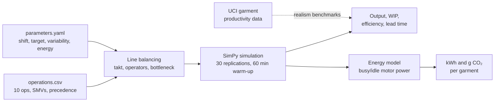
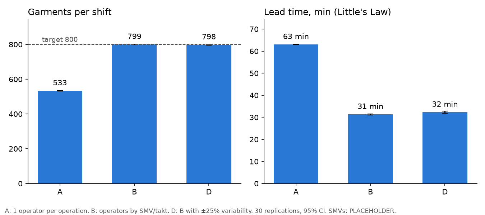
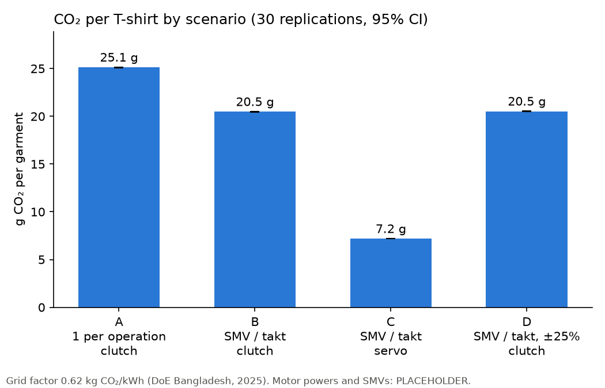
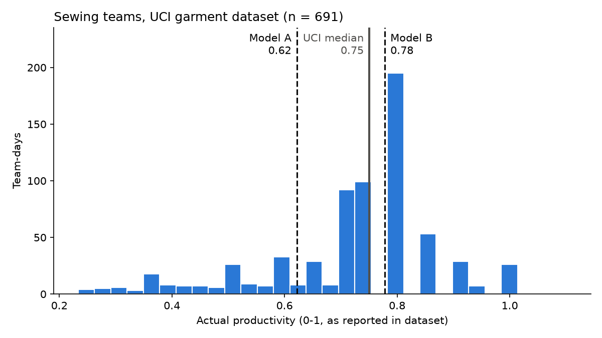

# Lean and Green Garment Sewing Line

A discrete-event simulation of a 10-operation T-shirt sewing line that measures how a **lean** change (line balancing) and a **green** change (servo motors) affect output, work-in-progress (WIP), lead time and CO₂ per garment.

> **Status:** the model and methods are complete, but most inputs are **PLACEHOLDER** values (see [Assumptions](#assumptions-still-placeholder)). Treat the numbers as a demonstration of the method, not as factory measurements.

## Research question

On a T-shirt sewing line with a target of 800 pieces per 8-hour shift:

1. How much do output, WIP and lead time improve when operators are allocated by takt time instead of one per operation?
2. How much electricity and CO₂ per garment does that save, and how does it compare with replacing clutch motors by servo motors?
3. How sensitive are these results to operation-time variability and to the uncertain motor power values?

## Method



1. **Inputs.** `data/operations.csv` lists 10 operations with their standard minute value (SMV, minutes per garment) and predecessors. The body flows 1→2→3→4→6→7→8→10, with two feeder operations: 5 (sleeve hem) feeds 6, and 9 (care label prep) feeds 7. `data/parameters.yaml` holds the line, variability and energy parameters.
2. **Line balancing** (`src/balancing.py`):
   - takt time = 480 min / 800 pcs = **0.60 min**
   - operators per operation = ⌈SMV / takt⌉
   - line cycle time = max(SMV / operators)
   - line efficiency = ΣSMV / (operators × cycle time)
3. **Simulation** (`src/simulation.py`, SimPy). Each operator is a process. Racks between operations hold at most 10 pieces, so an operator is *blocked* when its output rack is full and *starved* when its input rack is empty. Operation time is SMV × U(1 − v, 1 + v). Each scenario runs for 30 replications (seeds 1–30), with a 60-minute warm-up that is discarded and a 480-minute measured shift. Results are reported as mean ± 95% confidence-interval half-width (t = 2.045, n = 30).
4. **Lead time** uses Little's Law: lead time = mean WIP / throughput.
5. **Energy** (`src/energy.py`). Each machine draws running power while stitching (40% of its busy time) and idle power for the rest of the shift:
   - kWh = (P_run × stitch min + P_idle × idle min) / 60
   - CO₂ = kWh × 0.62 kg CO₂/kWh (Bangladesh grid)
6. **Realism check.** Results are compared with the UCI garment productivity dataset (691 sewing team-days).

## Scenarios

| Scenario | Operators | Allocation | Variability | Motor |
|---|---|---|---|---|
| A | 10 | one per operation | ±15% | clutch |
| B | 12 | ⌈SMV / takt⌉ (ops 6 and 7 get 2) | ±15% | clutch |
| C | 12 | as B | ±15% | **servo** |
| D | 12 | as B | **±25%** | clutch |

## Results

30 replications, 60-minute warm-up, 95% CI half-width in brackets.

| Scenario | Output / shift | Line efficiency | WIP / operator | Lead time (min) | kWh / garment | g CO₂ / garment |
|---|---|---|---|---|---|---|
| A | 532.9 (±0.7) | 0.623 | 6.99 | 63.0 (±0.1) | 0.0405 | 25.1 |
| B | 799.3 (±0.8) | 0.780 | 4.34 | 31.3 (±0.3) | 0.0330 | 20.5 |
| C | 799.3 (±0.8) | 0.780 | 4.34 | 31.3 (±0.3) | 0.0116 | 7.2 |
| D | 797.5 (±1.1) | 0.780 | 4.47 | 32.3 (±0.5) | 0.0331 | 20.5 |





### Key findings

- **Balancing (A → B):** adding 2 operators (+20%) to the bottleneck operations raises output by **50%** (533 → 799), roughly halves lead time (63 → 31 min), and cuts CO₂ per garment by **18.5%**. The saving comes from spreading the same idle motor energy over more garments.
- **Servo motors (B → C):** cut CO₂ per garment by a further **65%** (**−71%** compared with A). With clutch motors, idle power dominates electricity use.
- **Variability (B → D):** going from ±15% to ±25% costs only about 2 garments per shift, because the 10-piece racks absorb most of the fluctuation.
- **Rack size (scenario B):** shrinking racks from 20 to 3 pieces cuts WIP from 88.9 to 17.1 pieces and lead time from 54 to 10 min, while losing only about 1 garment per shift.
- **Sensitivity:** A → B stays at −18.5% under every test except a clutch idle power of 0.15 kW, where it falls to −14.8%. B → C ranges from −46% to −72%. **Clutch idle power** is the most influential assumption, so it should be sourced first. See `results/sensitivity_energy.csv`.

### Realism benchmarks (UCI dataset)

| Benchmark | UCI sewing (n = 691) | Model | Verdict |
|---|---|---|---|
| Line efficiency | median 0.75, IQR 0.66–0.80 | B: 0.78 | inside the IQR, near the top |
| WIP per operator | median 19.7, IQR 14–26 | B: 4.3 | lower, as expected: the model moves single pieces, while real lines move bundles |
| Interruptions | 2.6% of team-days | not modelled | guide for a future breakdown scenario |



## Limitations

- All SMVs, motor powers, the stitching fraction and the variability levels are placeholders, not measurements.
- Operation times are uniform. Real operation times are usually right-skewed.
- Single-piece flow. There are no bundles, breakdowns, absenteeism or supply shortages, and cut parts are always available.
- Operators work at 100% of SMV pace, with no allowances or learning curve.
- The clutch motor is assumed to draw full running power when idle, which is a simplification.
- The B vs D comparison uses separate confidence intervals. A paired-difference test would be more rigorous.
- The UCI teams have 52–58 operators, while this model has 10–12, so it represents one section of a real line. Also, the UCI "productivity" may not be defined exactly like SMV-based efficiency.

## Assumptions still PLACEHOLDER

- All 10 operation SMVs (0.25–0.90 min) and the precedence table
- Shift length 480 min, target 800 pcs/day (→ takt 0.60 min)
- Running power 0.30 kW per machine
- Clutch idle power = running power (0.30 kW)
- Servo idle power 0.02 kW
- Stitching fraction 40% of busy time
- Variability ±15% (base) and ±25% (scenario D)
- Rack capacity 10 pieces
- Unlimited cut parts at operations 1, 5 and 9
- Electricity price not set

## Sources

- **Grid emission factor, Bangladesh:** 0.62 kg CO₂/kWh (2020-21 and 2021-22). Department of Environment, Ministry of Environment and Forests, Bangladesh (Article 6 DNA), Ref. 22.02.0000.063.61.009.23-37, 23 Jan 2025. Methods: Bangladesh First Biennial Update Report to the UNFCCC (2023).
- **Garment productivity data:** UCI Machine Learning Repository, *Productivity Prediction of Garment Employees* (dataset 597), DOI [10.24432/C51S6D](https://doi.org/10.24432/C51S6D), CC BY 4.0. Imran, Rahim & Ahmed (2021), "Mining the productivity data of the garment industry", *Int. J. Business Intelligence and Data Mining*.

## Repository layout

```
data/        operations.csv, parameters.yaml, UCI CSV
src/         inputs.py, balancing.py, simulation.py, energy.py
notebooks/   01 UCI exploration, 02 SimPy basics, 03 simulation and energy
results/     scenario CSVs and figures (written by notebooks 01 and 03)
```

## How to run

Requires Python 3.12. From the repository root on Windows:

```bash
python -m venv .venv
```

```bash
.venv\Scripts\pip install -r requirements.txt
```

```bash
.venv\Scripts\jupyter notebook notebooks
```

Run the notebooks in order: 01, 02, 03. Notebook 03 writes `results/*.csv` and the figures, and takes a few minutes because it runs 30 replications per scenario. If you edit anything in `src/`, restart the kernel and run all cells again.
